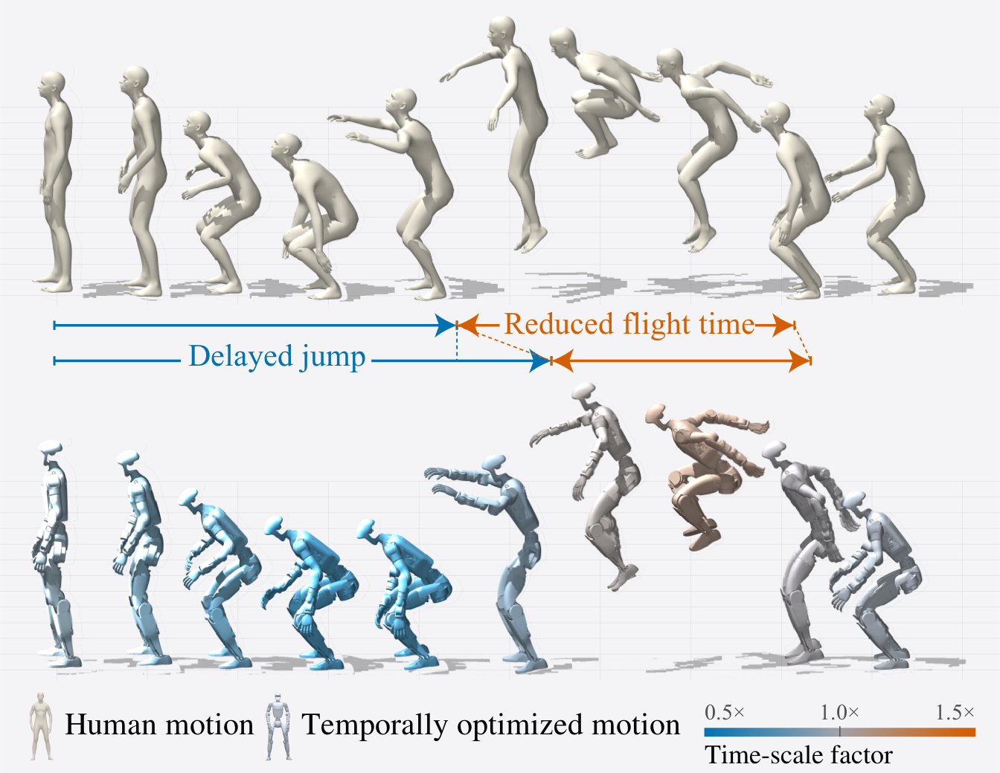
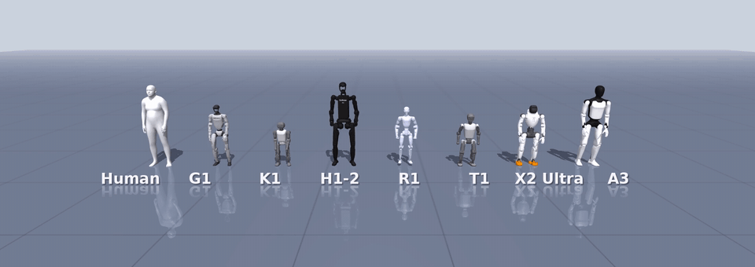
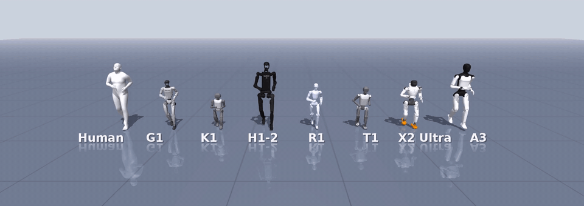

<div align="center">

# DTMR

**Dense Temporal Motion Retargeting for Legged Robots**

Jaeryeong Kim\* · Taerim Yoon\* · Jin Cheng · Sungjoon Choi · Stelian Coros<br>
Computational Robotics Lab, ETH Zürich · Korea University<br>
<sub>\*Equal contribution</sub>

[](https://jaeryeongnicolekim.com/Dense-Temporal-Motion-Retargeting-For-Legged-Robots/)
[](https://arxiv.org/abs/2609.38617)
[](https://youtu.be/_S1A0e5CaTE)
[](https://jaeryeongnicolekim.com/DTMR/)
[](LICENSE)



</div>

DTMR turns a kinematically retargeted human motion into a trajectory the robot can execute by optimizing timing and control together. The phase increment of the reference is a control input, adjusted at every control step, and the problem is solved by sampling-based model predictive control over thousands of parallel physics rollouts in MuJoCo Warp.

## Features

- **Dense temporal retargeting**: the reference's phase increment is part of the control, so only the parts of a motion the robot cannot keep up with are slowed down or sped up
- **Sampling-based MPC on the GPU**: annealed MPPI over spline-parameterized controls (descending from DIAL-MPC), on MuJoCo Warp
- **Seven humanoids**: Unitree G1, H1-2 and R1, Booster T1 and K1, AgiBot X2 Ultra and A3, each a descriptor file plus one release config
- **Any retargeter in**: importers for soma-retargeter, Unitree's LAFAN1 release, GMR, OmniRetarget and PHUMA output, a bundled keypoint retargeter for 100STYLE, and a ten-line hand-off for your own
- **Scores and videos out**: DTW and phase-aligned tracking metrics, an mp4 renderer that draws the reference as a translucent twin, and an optional Brax HTML replay

## Repository Structure

```
src/dtmr/
├── tracker/     annealed MPPI, the dtmr command
├── env/         phase-augmented environment and tracking cost (Warp kernels)
├── data/        importers, keypoint retargeter, handcrafted generators
├── post/        DTW and phase-tracking scores, Brax HTML replay
├── tools/       mp4 renderer, 100STYLE batch runner
├── robots/      one descriptor per robot
├── examples/    one release config per robot
└── models/      MJCF tracking scenes and meshes (vendor licences inside)
demo_scripts/    one-command demos: a 100STYLE clip, the tutorial's LAFAN1 walk
docs/            the documentation site
docker/          Dockerfile (CUDA 12.6, Ubuntu 22.04)
```

## Documentation

The guide lives at **[jaeryeongnicolekim.com/DTMR](https://jaeryeongnicolekim.com/DTMR/)**:

- **[Installation](docs/install.md)**, **[Quickstart](docs/quickstart.md)** and the **[Tutorial](docs/tutorial.md)** - from install to a tracked clip, its video and its scores
- **[Reference motions](docs/HUMAN_MOTION.md)** - every supported motion source and retargeter, with a worked guide per dataset:
  - **[Running a SEED motion](docs/SEED_GUIDE.md)** - one clip of the paper's data
  - **[Running the 100 styles](docs/STYLE100.md)** - whole-dataset batches
  - **[A LAFAN1 walk](docs/tutorial.md)** - the tutorial, end to end
- **[Supported robots](docs/robots.md)**, **[Adding a robot](docs/ADDING_A_ROBOT.md)**, **[Configuration](docs/configuration.md)**, **[Troubleshooting](docs/troubleshooting.md)**

## Quick Start

Linux with an NVIDIA GPU (CUDA 12 driver) and Python 3.10:

```bash
conda create -n dtmr python=3.10 -y && conda activate dtmr
pip install -e .
```

One command each: a freely licensed 100STYLE clip on the G1 (download once, retarget, track, render), or the [tutorial](docs/tutorial.md)'s LAFAN1 walk:

```bash
bash demo_scripts/demo_100style.sh        # any style: bash demo_scripts/demo_100style.sh TwoFootJump
bash demo_scripts/demo_lafan1.sh
```

Track any retargeted clip with its robot's release config, then watch it:

```bash
dtmr --config src/dtmr/examples/unitree_g1_release_warp.yaml \
    --motion_path data/<clip>/<clip>_50Hz.npz --output_dir output/<clip> --no_viz
python -m dtmr.tools.render_rollout --run output/<clip> --robot unitree_g1 \
    --ref data/<clip>/<clip>_50Hz.npz --out output/<clip>/rollout.mp4
```

The [tutorial](docs/tutorial.md) builds that reference from a download; the paper's own data, SEED, goes through soma-retargeter in the [SEED walkthrough](docs/SEED_GUIDE.md).

## Demo

<div align="center">
<br>
<sub>SEED <code>high_jump_R_001__A277</code>, half speed</sub><br><br>
<br>
<sub>SEED <code>jog_ff_loop_180_R_slow_002__A447</code></sub><br><br>
<sub>The SEED human and, left to right, G1, K1, H1-2, R1, T1, X2 Ultra and A3 tracking the same clip with DTMR in MuJoCo, each with its release config.</sub>
</div>

## Issue Reporting

Open an [issue](https://github.com/nicolejrkim/DTMR/issues) for a command that does not work as written, or for a robot, retargeter or motion format you need; we will do our best to support it.

## Citation

```bibtex
@misc{kim2026dtmr,
  title         = {Dense Temporal Motion Retargeting for Legged Robots},
  author        = {Kim, Jaeryeong and Yoon, Taerim and Cheng, Jin and Choi, Sungjoon and Coros, Stelian},
  year          = {2026},
  eprint        = {2609.38617},
  archivePrefix = {arXiv},
  primaryClass  = {cs.RO},
  doi           = {10.48550/arXiv.2609.38617},
  url           = {https://arxiv.org/abs/2609.38617}
}
```

## License

Apache-2.0, see [`LICENSE`](LICENSE). The controller derives from [DIAL-MPC](https://github.com/LeCAR-Lab/dial-mpc) (Apache-2.0); see [`NOTICE`](NOTICE). Robot descriptions keep their vendors' licences inside each `src/dtmr/models/<robot>/`. The paper's reference motions are SEED, used under the Bones Studio Dataset License Agreement and not redistributed: **Motion Data by Bones Studio (https://bones.studio/)**; anything published from SEED clips must carry that credit.
