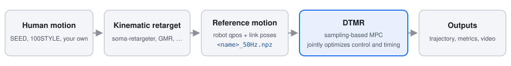

# DTMR

**Dense Temporal Motion Retargeting for Legged Robots**

Jaeryeong Kim\* · Taerim Yoon\* · Jin Cheng · Sungjoon Choi · Stelian Coros<br>
Computational Robotics Lab, ETH Zürich · Korea University<br>
<sub>\*Equal contribution</sub>

[Project page](https://jaeryeongnicolekim.com/Dense-Temporal-Motion-Retargeting-For-Legged-Robots/) ·
[Paper](https://arxiv.org/abs/2609.38617) ·
[Video](https://youtu.be/_S1A0e5CaTE) ·
[Code](https://github.com/nicolejrkim/DTMR)


DTMR turns a retargeted human motion into a trajectory the robot can execute by
optimizing **timing and control together**. The phase increment of the reference is a
control input, so the robot slows down or speeds up through the motion wherever its
dynamics require it, and *dense* means the timing is adjusted at every control step:
only the parts of a motion that need a change in timing are deformed. The problem is
solved by sampling-based model predictive control, thousands of physics rollouts in
parallel on a GPU.

## Where DTMR sits



DTMR starts from a motion that is already on the robot's skeleton. Mapping a human onto
the robot (kinematic retargeting) is a separate step done by a tool such as
soma-retargeter; DTMR then makes the robot's *dynamics* follow that motion and decides,
step by step, how fast to play it.

## Seven robots, one clip

<br>
<sub>SEED <code>high_jump_R_001__A277</code>, half speed</sub>

<br>
<sub>SEED <code>jog_ff_loop_180_R_slow_002__A447</code>, everyone held in their lane</sub>

The SEED human and, left to right, G1, K1, H1-2, R1, T1, X2 Ultra and A3 tracking the
same clip with DTMR in MuJoCo, each with its release config.

## Where to start

- [Installation](install.md), then the [Quickstart](quickstart.md): a 100STYLE clip on
  the G1, end to end.
- [Tutorial](tutorial.md): your own clip, from download to video and scores.
- [Reference motions](HUMAN_MOTION.md): every supported motion source and retargeter,
  with a worked guide per dataset:
  - [Running a SEED motion](SEED_GUIDE.md): one clip of the paper's data.
  - [Running the 100 styles](STYLE100.md): whole-dataset batches.
  - [Running a LAFAN1 sprint](tutorial.md): the tutorial, end to end.
- [Supported robots](robots.md), [Adding a robot](ADDING_A_ROBOT.md),
  [Configuration](configuration.md), [Troubleshooting](troubleshooting.md).

```{toctree}
:hidden:
:caption: Getting started

install
quickstart
tutorial
```

```{toctree}
:hidden:
:caption: Reference motions

HUMAN_MOTION
SEED_GUIDE
STYLE100
```

```{toctree}
:hidden:
:caption: Robots and runs

robots
ADDING_A_ROBOT
configuration
```

```{toctree}
:hidden:
:caption: Help

troubleshooting
```

## Questions and issues

These pages are kept in step with the code and will keep improving. If a command does
not work as written, or you need a robot, a retargeter or a motion format that is not
covered, open an [issue](https://github.com/nicolejrkim/DTMR/issues) and we will do our
best to support it.

## Citation

```bibtex
@misc{kim2026dtmr,
  title         = {Dense Temporal Motion Retargeting for Legged Robots},
  author        = {Kim, Jaeryeong and Yoon, Taerim and Cheng, Jin and Choi, Sungjoon and Coros, Stelian},
  year          = {2026},
  eprint        = {2609.38617},
  archivePrefix = {arXiv},
  primaryClass  = {cs.RO},
  doi           = {10.48550/arXiv.2609.38617},
  url           = {https://arxiv.org/abs/2609.38617}
}
```

## Licence

Apache-2.0. The controller is derived from
[DIAL-MPC](https://github.com/LeCAR-Lab/dial-mpc) (Apache-2.0); see
[NOTICE](../NOTICE). Robot descriptions keep their vendors' licences, inside each
`src/dtmr/models/<robot>/`. The paper's reference motions come from SEED, used under the
Bones Studio Dataset License Agreement and not redistributed: **Motion Data by Bones
Studio (https://bones.studio/)**.
